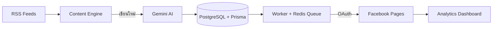

# 🐝 Newszeed — หุ่นยนต์โพสต์ข่าวเข้าเพจ Facebook อัตโนมัติ

> **AI-powered news autoposter for Thai Facebook Pages** — fetch RSS → rewrite with Gemini → auto-post to your Pages, with analytics.

สร้างระบบข่าวอัตโนมัติของตัวเอง: ดึงข่าวจาก RSS ที่คุณเลือก → AI (Gemini) เขียนใหม่เป็นโพสต์ภาษาไทยสไตล์ viral → โพสต์เข้าเพจ Facebook ของคุณอัตโนมัติผ่านคิวที่เชื่อถือได้ → ดู Reach / Engagement ในแดชบอร์ดเดียวจบ

## ✨ ฟีเจอร์

- **Content Engine** — ดึงข่าวจากหลาย RSS, ให้ Gemini เขียนใหม่เป็นโพสต์ไทย, หรือพิมพ์เองก็ได้
- **Facebook Publisher** — เชื่อมหลายเพจผ่าน OAuth, คิวโพสต์ Redis-backed, retry อัตโนมัติ
- **Analytics Dashboard** — ติดตาม Reach, Engagement, รายได้ และประสิทธิภาพแยกตาม niche

## 🧱 สถาปัตยกรรม



**Stack:** Next.js (App Router) · TypeScript · Prisma + PostgreSQL · Redis Queue + Worker · Gemini API · Facebook Graph API · Tailwind · Docker (dev/prod)

## 🚀 ติดตั้งเองใน 15 นาที (ฟรีทั้งหมด)

### 1) เตรียมของ 4 อย่าง (มี free tier ครบ)

| บริการ | ได้อะไร | ราคา |
|---|---|---|
| [Neon](https://neon.tech) | PostgreSQL | ฟรี |
| [Upstash](https://upstash.com) | Redis | ฟรี |
| [Google AI Studio](https://aistudio.google.com) | `GEMINI_API_KEY` | ฟรี |
| [Facebook Developers](https://developers.facebook.com) | `FB_APP_ID` / `FB_APP_SECRET` (สร้าง App แล้วขอสิทธิ์ `pages_manage_posts`, `pages_read_engagement`) | ฟรี |

### 2) ติดตั้ง

```bash
git clone https://github.com/fancyism/newszeed.git
cd newszeed
pnpm install
cp .env.example .env   # แล้วกรอกค่าทั้งหมด
npx prisma generate && npx prisma db push
pnpm dev               # dashboard → http://localhost:3000
pnpm worker            # เปิดอีก terminal สำหรับ worker ประมวลผลคิว
```

### 3) Deploy ขึ้น production

**Vercel (แนะนำ):** Fork repo → Import ใน Vercel → ใส่ env ทั้งหมดใน Project Settings → Deploy (worker รันแยกด้วย long-running service หรือ cron)

**Docker:** `docker compose -f docker/prod/docker-compose.yml up -d`

## 📬 อยากได้ template + อัปเดต?

กำลังรวบรวมชุด **"RSS ไทยคุณภาพ + prompt โพสต์ข่าว viral"** ส่งฟรีให้ผู้ที่ลงอีเมล → **[รับได้ที่นี่](NEWSZEED_LANDING_URL)**

## ❓ FAQ

- **ใช้ฟรีจริงไหม?** จริง — ทุกบริการที่ใช้มี free tier พอสำหรับเพจขนาดเล็ก-กลาง
- **ต้องมีเพจ FB กี่เพจถึงคุ้ม?** ตั้งแต่ 1 เพจก็ออมแรงได้แล้ว ยิ่งหลายเพจยิ่งคุ้ม
- **โพสต์ผิดนโยบาย FB ไหม?** ใช้ Graph API ทางการ + OAuth ของเพจตัวเอง เป็นการโพสต์ที่ถูกต้องตามที่ Facebook ออกแบบไว้ (แต่คอนเทนต์ต้องไม่ spam อยู่ดี)

## 📄 License

[MIT](LICENSE.md) — เอาไปใช้ แก้ ขายต่อได้ตามสบาย
